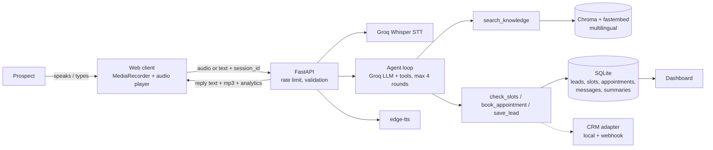

# AI Sales Voice Agent (Fortivex AI, Round 3 prototype)

A voice agent for **BrightPath Academy** (a fictional education-counselling institute). It talks to a prospect, answers questions from a knowledge base (RAG), qualifies the lead, books a counselling appointment, saves the lead to a CRM, and produces a call summary with insights. Hindi, English and Punjabi are supported.

## 1-page report

**Problem.** Inbound enquiries are lost because human callers are slow, costly, limited to working hours and inconsistent at qualifying leads.

**Solution.** A browser-based voice agent (push-to-talk, with a typed-text fallback). Each turn: audio → Whisper STT (language auto-detected, or pinned in the UI) → LLM with tool calling → edge-tts voice reply. The LLM uses four tools: `search_knowledge` (RAG over multilingual embeddings), `check_slots`, `book_appointment` and `save_lead`. Every turn also returns sentiment and intent from the same LLM call, so there is no extra cost. The **lead score is computed in code** from a transparent rubric (interest +20, budget +20, timeline within a month +20, phone +10, asked pricing +10, booked +20, negative sentiment −20), never by the LLM. At the end of the call, one LLM call stores a summary, objections, interest level and next best action. The dashboard shows leads, appointments, sentiment and summaries.

**Architecture.**



**Commercial feasibility.** Cost per call is STT + LLM tokens + TTS (plus telephony if phone calls are added). With a small LLM, about 8 turns of 1-3 sentence replies and short audio, this is a small fraction of a human telecaller's cost per qualified lead, and it works 24x7 in three languages. LLM and telephony usually dominate cost. The levers are short replies, a cheaper model for simple turns, caching and self-hosted STT. Verify against current vendor prices; the demo runs on free tiers.

**Scalability to 1,00,000 users (designed, not built).** Treat 1,00,000 registered users as roughly 2,000 to 5,000 concurrent calls at peak. Stateless agent workers autoscale behind a load balancer. Session state moves to Redis. SQLite becomes PostgreSQL (PgBouncer, read replicas, `messages` partitioned by date) and Chroma becomes pgvector or a managed vector DB. Summaries and CRM sync run off the call path via a queue (SQS/Celery) with retries. An LLM gateway adds rate-limit handling, fallback models and caching. Turn-based HTTP is replaced by WebRTC/WebSocket streaming with VAD, and Whisper is self-hosted on GPUs at volume. The booking path is already concurrency-safe (UNIQUE constraint + transaction).

**Security.** Secrets come only from `.env`. All SQL is parameterised. Every API input and every LLM-produced tool argument is validated with Pydantic (extra fields forbidden). Tools are scoped to the current session and expose no SQL, URLs or file paths. Audio uploads have size and type limits, and there are per-IP and per-session rate limits. Max turns, max call duration and a 4-round tool cap bound each call. CORS is limited to configured origins and responses carry security headers. Phone numbers are masked in logs, a consent notice is spoken at call start, and a retention setting plus `scripts/purge.py` handle deletion. Caller speech is treated as untrusted (prompt-injection rules in the system prompt). Production additions: TLS, encryption at rest, auth + RBAC on the dashboard, DPDP-compliant erasure.

## Setup and run

```bash
python3 -m venv .venv && .venv/bin/pip install -r requirements.txt
cp .env.example .env                        # then put your GROQ_API_KEY in .env
.venv/bin/python scripts/seed_slots.py      # demo appointment slots
.venv/bin/python scripts/ingest.py          # build the vector index (downloads ~220MB model once)
.venv/bin/python scripts/smoke_test.py      # optional: checks Groq, voices, embeddings
.venv/bin/python -m pytest -q               # tests (no API key needed)
.venv/bin/uvicorn app.main:app --port 8000  # open http://localhost:8000 in Chrome
.venv/bin/python scripts/chat_cli.py        # or chat in the terminal
```

Dashboard: `http://localhost:8000/web/dashboard.html`.

Demo script: ask about data-science fees → ask in Hindi → give name, budget, timeline and phone → agree to a slot → End call → open the dashboard.

See `BUILD_LOG.md` for the honest status of every feature, the controls table and the known limitations.
