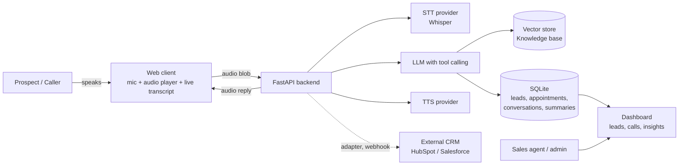
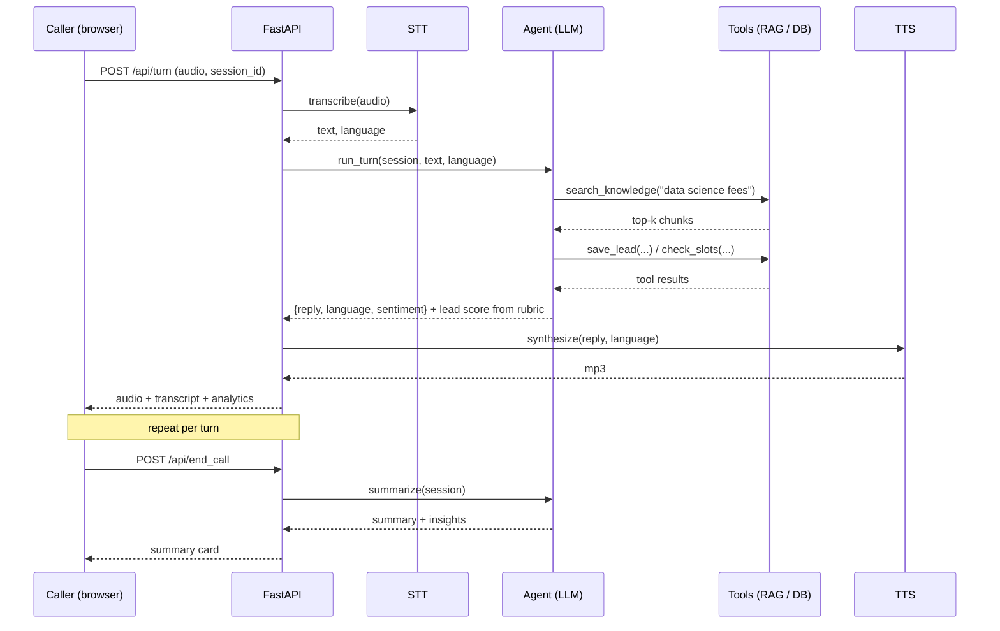
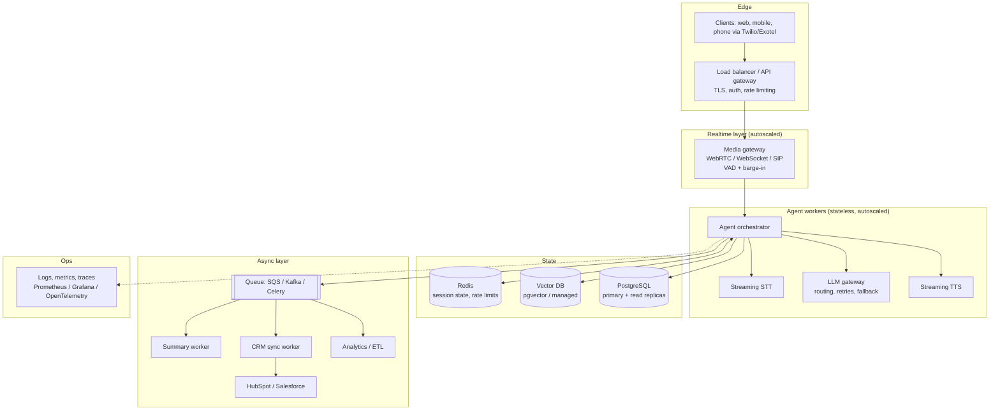

# Autonomous AI Sales Voice Agent — Architecture

> Fortivex AI · Round 3 project · Single-developer MVP with a production-scale design
> Status legend: ✅ built in MVP · 🟡 built if time permits · 📐 designed only (documented, not coded)

---

## 1. Problem & Goal

**Business problem.** Sales teams lose leads because human callers are slow, expensive, available only in working hours, and inconsistent at qualifying. Most inbound enquiries go unanswered or are qualified badly.

**Solution.** A voice agent that talks to a prospect, answers product questions from a knowledge base, qualifies the lead, books an appointment with a human salesperson, saves the lead to a CRM, and produces a call summary with insights.

**Demo business (placeholder, swap freely).** A fictional education-counselling institute, "BrightPath Academy". The domain is configurable through `kb/` documents and one system-prompt file, so nothing in the code is domain-specific.

**Design principle.** The MVP implements one complete end-to-end workflow with simple parts. Every remaining feature has a clearly documented upgrade path. Where the MVP differs from production, the swap point is a single module, noted in this document.

---

## 2. Scope Matrix

| Requirement from the brief | MVP approach | Status | Production approach |
|---|---|---|---|
| Real-time voice (STT + TTS) | Push-to-talk, turn-based over HTTP | ✅ | WebRTC / WebSocket streaming, VAD, barge-in |
| Contextual memory | Session message history + rolling summary | ✅ | Redis session store + long-term customer memory in Postgres |
| Multilingual | Auto language detection in STT, reply in the caller's language | ✅ | Per-language TTS voices, language-specific prompts and KB |
| Lead qualification | Tool call `save_lead` with structured fields and a score | ✅ | Configurable qualification rubric (BANT), score calibration |
| Sentiment analysis | Per-turn field in structured LLM output | ✅ | Dedicated model plus audio-tone features |
| RAG | Chunk → embed → vector search as a tool | ✅ | Managed vector DB, hybrid search, reranker |
| Appointment booking | Slots table in SQLite, tools `check_slots`, `book_appointment` | ✅ | Google Calendar / Outlook API, timezone handling |
| CRM integration | `leads` table plus an adapter interface and webhook stub | ✅ / 📐 | HubSpot / Salesforce adapter via async queue |
| Call summary and insights | One LLM call at end of call, saved to DB, shown on dashboard | ✅ | Async worker, aggregate analytics |
| Telephony (real phone calls) | Not included; browser mic stands in | 📐 | Twilio / Exotel SIP → media stream into the same agent core |
| Scale to 1,00,000 users | Documented design and cost model (section 13) | 📐 | See section 13 |

---

## 3. System Context



---

## 4. Component Design

### 4.1 Web client (`web/index.html`)
- Push-to-talk button using the browser `MediaRecorder` API (records `webm/opus`).
- Sends the audio blob to `POST /api/turn`.
- Plays the returned audio and appends both sides to a live transcript.
- Shows per-turn sentiment and the running lead score. This makes the intelligence visible in the demo.
- A "End call" button triggers the summary.

### 4.2 API layer (`app/main.py`)
FastAPI, stateless per request except for the session store. Endpoints in section 7.

### 4.3 STT module (`app/stt.py`)
- Input: audio bytes. Output: `{text, language}`.
- Provider: Whisper (`whisper-large-v3-turbo`) through Groq (fast, free tier, multilingual).
- Call it with `response_format="verbose_json"`: that is what returns the detected `language` alongside the text. Normalise the returned value (a name like "hindi" or a code like "hi") to a 2-letter code in one small map.
- Interface is one function, `transcribe(audio) -> Transcript`, so providers can be swapped (Deepgram, self-hosted faster-whisper).

### 4.4 Agent core (`app/agent.py`)
The brain. It owns the conversation loop:

1. Build messages: system prompt + rolling summary + recent turns + new user text.
2. Call the LLM with the tool definitions.
3. If the LLM requests tools, execute them, append results, and call the LLM again. Cap at 4 iterations to prevent loops.
4. Parse the final JSON output (section 8.2) defensively: `try json.loads`, and on failure treat the raw text as `reply` with neutral sentiment. Do NOT use the provider's `response_format` / structured-output mode together with tool calling (Groq documents that tool use is not supported with Structured Outputs). Ask for JSON in the prompt instead.
5. Persist the turn and return `reply_text` plus analytics.

### 4.5 Tools (`app/tools.py`)
Plain Python functions with JSON schemas. The LLM decides when to call them.

| Tool | Purpose | Backing store |
|---|---|---|
| `search_knowledge(query)` | RAG lookup for product, fee, and policy questions | Vector store |
| `check_slots(date)` | List available appointment slots | `slots` table |
| `book_appointment(slot_id, name, phone)` | Reserve a slot, with a transaction to prevent double booking | `appointments` table |
| `save_lead(name, phone, interest, budget, timeline, notes)` | Create or update the lead record; the score is computed in code (section 8.3), never passed by the LLM | `leads` table, then CRM adapter |

### 4.6 RAG module (`app/rag.py`)
Described in section 9.

### 4.7 TTS module (`app/tts.py`)
- Input: text and language. Output: audio bytes (mp3).
- Provider: `edge-tts` (free, many languages and voices; it is an unofficial wrapper around Microsoft's online service, so it needs internet and can occasionally fail). Voice picked from a language → voice map. Build the map from `edge-tts --list-voices` output rather than assuming a voice exists (Punjabi availability in particular must be checked); fall back to Hindi, then English.
- Interface: `synthesize(text, language) -> bytes`. Swappable (ElevenLabs, Azure, Google).

### 4.8 Persistence (`app/db.py`)
SQLite through plain `sqlite3`. Schema in section 6. Live conversation history sits in an in-process dict keyed by `session_id` (fine for one demo server) and every message is also written to `messages`, so a restart loses only the active call's memory. Chosen for zero setup, and the schema ports directly to Postgres.

### 4.9 CRM adapter (`app/crm.py`)
```python
class CRMAdapter(Protocol):
    def upsert_lead(self, lead: Lead) -> str: ...
```
MVP implementation writes to the local `leads` table and optionally POSTs to a webhook URL. A `HubSpotAdapter` is documented but not coded.

### 4.10 Dashboard (`web/dashboard.html`)
Reads `GET /api/leads` and `GET /api/calls`. Shows leads with score, call summaries, sentiment trend, and booked appointments.

---

## 5. End-to-End Workflow (the one we demonstrate)

**Scenario:** A prospect asks about a course, asks about fees, gets qualified, and books a counselling session.



**Conversation state machine (kept in the system prompt, not hard-coded):**
`Greeting → Discovery → Answer questions (RAG) → Qualify → Offer appointment → Confirm booking → Close`

---

## 6. Data Model

```sql
CREATE TABLE sessions (
  id            TEXT PRIMARY KEY,
  started_at    TIMESTAMP,
  ended_at      TIMESTAMP,
  language      TEXT,
  status        TEXT            -- active | ended
);

CREATE TABLE messages (
  id            INTEGER PRIMARY KEY,
  session_id    TEXT REFERENCES sessions(id),
  role          TEXT,           -- user | assistant | tool
  content       TEXT,
  language      TEXT,
  sentiment     TEXT,           -- positive | neutral | negative
  created_at    TIMESTAMP
);

CREATE TABLE leads (
  id            INTEGER PRIMARY KEY,
  session_id    TEXT REFERENCES sessions(id),
  name          TEXT,
  phone         TEXT,
  interest      TEXT,
  budget        TEXT,
  timeline      TEXT,
  score         INTEGER,        -- 0-100
  stage         TEXT,           -- new | qualified | booked | lost
  notes         TEXT,
  crm_id        TEXT,           -- id returned by external CRM
  updated_at    TIMESTAMP
);

CREATE TABLE slots (
  id            INTEGER PRIMARY KEY,
  start_time    TIMESTAMP,
  is_booked     INTEGER DEFAULT 0
);

CREATE TABLE appointments (
  id            INTEGER PRIMARY KEY,
  slot_id       INTEGER UNIQUE REFERENCES slots(id),   -- UNIQUE prevents double booking
  lead_id       INTEGER REFERENCES leads(id),
  created_at    TIMESTAMP
);

CREATE TABLE call_summaries (
  session_id    TEXT PRIMARY KEY REFERENCES sessions(id),
  summary       TEXT,
  insights_json TEXT,           -- objections, interest level, next best action
  overall_sentiment TEXT,
  final_score   INTEGER
);
```

---

## 7. API Surface

| Method | Path | Description |
|---|---|---|
| POST | `/api/session` | Start a call; returns `session_id` and the greeting audio |
| POST | `/api/turn` | Body: audio + `session_id`. Returns transcript, reply text, reply audio (base64 or URL), sentiment, lead score |
| POST | `/api/end_call` | Ends the session and generates the summary and insights |
| GET | `/api/leads` | List leads |
| GET | `/api/calls` | List calls with summaries |
| GET | `/api/slots` | List slots (debug and dashboard) |
| GET | `/health` | Liveness check |

---

## 8. Agent Design

### 8.1 System prompt structure
1. **Role.** You are a friendly sales assistant for {business}. Keep replies to 1–3 short sentences, since this is a voice call.
2. **Language.** Reply in the language the caller used in their last message.
3. **Grounding.** Answer product facts only from `search_knowledge` results. If the answer is not found, say so and offer a callback. Never invent prices.
4. **Qualification goals.** Collect name, interest, budget, timeline, and phone, naturally, one question at a time.
5. **Booking rule.** Offer an appointment once the lead shows interest. Always call `check_slots` before proposing times, and `book_appointment` only after the caller confirms.
6. **Output contract.** Return the JSON in 8.2.

Voice-specific rules matter: no bullet points, no markdown, no long lists, numbers spoken in words where natural.

### 8.2 Per-turn structured output
```json
{
  "reply": "text to speak",
  "language": "en | hi | pa | ...",
  "sentiment": "positive | neutral | negative",
  "intent": "pricing_question | ready_to_book | objection | smalltalk | ..."
}
```
Only `reply` goes to TTS. The remaining fields feed the dashboard. This produces sentiment and intent at no extra LLM call. The lead score is not in this JSON; it is computed in code (8.3).

### 8.3 Lead scoring (simple, explainable)
The score is computed by a plain deterministic function in code from the saved lead fields, booking status, and latest sentiment. The LLM never guesses it:

| Signal | Points |
|---|---|
| Stated clear interest or need | +20 |
| Budget given and matches offering | +20 |
| Timeline within 1 month | +20 |
| Phone number provided | +10 |
| Asked about pricing or enrolment steps | +10 |
| Appointment booked | +20 |
| Negative sentiment or explicit refusal | −20 |

Being able to explain this rubric in the interview matters more than the exact numbers.

### 8.4 Memory
- **Short-term:** last N messages are passed verbatim.
- **Rolling summary:** when history exceeds a limit, older turns are compressed into a summary message. This bounds token cost and latency.
- **Long-term (📐):** per-customer facts in Postgres, keyed by phone number, loaded at call start for returning callers.

### 8.5 Safety and guardrails
- Tool-call loop capped at 4 iterations.
- Tool arguments validated with Pydantic before execution.
- Prompt-injection stance: caller speech is untrusted input. Tools can only touch the caller's own session and the lead record, never arbitrary data.
- Hallucination control: refusal path when RAG returns nothing relevant (similarity threshold).

---

## 9. RAG Design

**Ingestion (offline, `scripts/ingest.py`)**
1. Load documents from `kb/` (markdown or text: courses, fees, FAQs, policies).
2. Split into chunks of about 300–500 tokens with about 50 tokens overlap.
3. Embed each chunk with `fastembed` (ONNX, runs locally, no PyTorch install) using `sentence-transformers/paraphrase-multilingual-MiniLM-L12-v2`, so Hindi and Punjabi queries match English documents. Avoid the full `sentence-transformers` package: it pulls in PyTorch, a multi-GB install that can eat an hour on a bad connection.
4. Store vectors and metadata (`source`, `section`) in Chroma (persisted locally), passing the embeddings in explicitly instead of using Chroma's default English-only embedder.

**Query (online, `search_knowledge`)**
1. Embed the query.
2. Top-k = 4 by cosine similarity.
3. Apply a similarity threshold. If nothing passes, return "no relevant information".
4. Return chunks with sources to the LLM, which answers from them.

**Why this design is defensible**
- Retrieval is a **tool**, not an always-on step. Small talk ("hello") skips retrieval, saving latency and cost.
- Metadata filtering (for example `{"course": "data-science"}`) is where filtered vector search applies. This connects directly to the VeloFilter capstone work and is a good interview talking point.

**Upgrade path (📐):** hybrid BM25 plus vector search, cross-encoder reranker, query rewriting using conversation context, pgvector or a managed vector DB.

---

## 10. Multilingual Strategy

1. STT detects the language automatically.
2. The language code is passed into the agent, and the system prompt instructs replying in that language.
3. TTS picks a voice from a `language → voice` map, with an English fallback.
4. The KB stays in English. Multilingual embeddings handle cross-language retrieval, and the LLM translates in its answer.

**Known limits to state honestly:** Punjabi STT/TTS quality is weaker than Hindi and English, and code-mixed speech (Hinglish) can confuse language detection. Mitigation: allow the user to pin a language in the UI.

---

## 11. Latency Budget (turn-based MVP)

| Stage | Target |
|---|---|
| Upload + STT | 0.4–0.8 s |
| LLM (with one tool round) | 1–2.5 s |
| TTS | 0.4–0.9 s |
| **Total per turn** | **~2–4 s** |

**Optimisations to mention:** stream the LLM output and begin TTS on the first sentence, cache TTS for common phrases (greeting, fillers), keep replies short, use a small fast model for chit-chat.

---

## 12. Repository Layout

```
voice-sales-agent/
├── README.md              # includes the 1-page report
├── architecture.md        # this file
├── docs/
│   └── architecture.png   # exported diagram for the interview
├── app/
│   ├── main.py            # FastAPI routes
│   ├── agent.py           # conversation loop, tool calling, summary
│   ├── tools.py           # tool schemas and implementations
│   ├── stt.py             # speech-to-text
│   ├── tts.py             # text-to-speech
│   ├── rag.py             # retrieval
│   ├── crm.py             # CRM adapter interface and stub
│   ├── db.py              # schema and queries
│   └── config.py          # env vars, model names, thresholds
├── kb/                    # knowledge base documents
├── scripts/
│   ├── ingest.py          # build vector index
│   └── seed_slots.py      # create demo appointment slots
├── web/
│   ├── index.html         # call UI
│   └── dashboard.html     # leads and summaries
├── tests/
│   └── test_tools.py      # booking and scoring tests
├── .env.example
└── requirements.txt
```

Rule of thumb for live coding: every file should be small enough that the developer can explain it line by line.

---

## 13. Production Architecture and Scalability (target: 1,00,000 users)

### 13.1 Interpreting "1,00,000 users"
Registered users are not concurrent users. Plan on two numbers:
- **Daily active:** about 10% → 10,000 users
- **Peak concurrent calls:** about 2–5% of registered → **2,000–5,000 simultaneous calls**

Design for the concurrent figure, since it drives cost and infrastructure.

### 13.2 Target architecture



### 13.3 How each scaling problem is solved

| Concern | Strategy |
|---|---|
| Stateless compute | Agent workers keep no local state, so horizontal autoscaling on concurrent-session count and CPU |
| Session state | Redis with TTL, so any worker can resume any session |
| Database | Postgres with connection pooling (PgBouncer), read replicas for the dashboard, partition `messages` by date |
| Slow side-effects | Summaries and CRM sync run off the call path through a queue, with retries and a dead-letter queue |
| Vendor rate limits | LLM gateway with token-bucket limiting, retries with backoff, and fallback to a secondary provider or smaller model |
| Latency | Streaming everywhere, regional deployment near users, prompt/response caching for common FAQs |
| Cost | Route simple turns to a cheaper model, cache RAG results, self-host Whisper on GPUs at high volume |
| Double-booking at scale | Database unique constraint on `slot_id` plus transactional insert (already in the MVP schema) |
| Availability | Multi-AZ deployment, health checks, graceful drain of live calls during deploys |

### 13.4 Cost model (illustrative, verify against current vendor pricing)

Per-minute cost is the sum of three parts: STT, LLM tokens, and TTS. Worked structure for a 3-minute call:

```
STT      : audio minutes × STT price per minute
LLM      : (input tokens + output tokens) per turn × ~8 turns × price per token
TTS      : characters spoken × TTS price per character
Telephony: per-minute carrier charge (if using phone calls)
Infra    : compute + DB + Redis + egress, amortised per call
```

Use this as a template and fill current prices live in the interview, instead of quoting memorised figures. Key insight to state: **LLM and telephony typically dominate cost, and TTS is the next largest.** Levers are shorter replies, smaller models for simple turns, caching, and self-hosted STT.

**Commercial feasibility.** Compare cost per qualified lead against a human telecaller's cost per qualified lead (salary, hours, conversion). A voice agent is viable if cost per call is a small fraction of a human's and it works 24×7 across languages.

---

## 14. Security, Privacy and Compliance

| Area | Control |
|---|---|
| Transport | TLS everywhere; WSS for realtime |
| Secrets | API keys in environment or a secrets manager; never committed (`.env.example` only) |
| PII (name, phone) | Encrypt at rest; mask in logs; role-based access to the dashboard |
| Call recording | Play a consent notice at call start; store audio only if consented; retention policy (for example 30–90 days) with auto-delete |
| Regulation | Indian DPDP Act: purpose limitation, consent, right to erasure; telemarketing rules (DND registry) for outbound calling |
| Abuse | Rate limiting per IP and per session; max call duration; max tool iterations |
| Prompt injection | Caller input treated as untrusted; tools scoped to the current session; no tool exposes raw SQL or arbitrary URLs |
| Vendor data | Prefer providers with a no-training-on-data policy; document which vendor sees which data |
| Audit | Every tool call and booking logged with session id and timestamp |

---

## 15. Deployment

**MVP (demo):** run locally with `uvicorn`; Docker optional; one command to seed slots and build the KB index.

**Production path:**
- Containerise (`Dockerfile`), run on Kubernetes or a managed container service (ECS / Cloud Run).
- CI: lint, unit tests, build image, deploy through staged environments.
- Config through environment variables; infrastructure as code (Terraform).
- Blue/green deploys with graceful call draining.

---

## 16. Observability and Quality

- **Metrics:** latency per stage (STT, LLM, TTS), tool-call success rate, booking conversion, cost per call, error rate.
- **Tracing:** one trace id per turn across all stages.
- **Conversation evaluation:** replay transcripts against a small test set (expected tool calls, groundedness, language correctness). This is where evaluation experience is a strength.
- **Alerts:** p95 latency, vendor error spikes, queue backlog.

---

## 17. Failure Modes and Handling

| Failure | Handling |
|---|---|
| STT returns empty or low confidence | Agent says "Sorry, could you repeat that?" |
| LLM timeout or error | Retry once, then fall back to a canned apology and offer a callback |
| RAG finds nothing | Agent states it doesn't have that information and offers a human follow-up |
| Slot taken between check and book | Unique constraint rejects it; agent re-offers fresh slots |
| TTS failure | Show text reply in UI; retry; fall back to the browser's speech synthesis |
| CRM down | Queue the sync with retries; the lead is already safe in the local DB |
| Network failure at venue | Pre-recorded demo video as backup |

---

## 18. Key Design Decisions

| Decision | Chosen | Alternative | Reason |
|---|---|---|---|
| Interaction model | Turn-based push-to-talk | Full-duplex streaming | Same pipeline with a fraction of the complexity; transport is the only thing that changes later |
| Retrieval | As an LLM tool | Always retrieve | Saves latency and cost; the model decides when it needs facts |
| Analytics | Inside per-turn structured output | Separate classifier call | No extra latency or cost |
| Database | SQLite | Postgres | Zero setup for the demo; schema is portable |
| Vector store | Chroma (local) | pgvector / managed | Simple to run and explain; swappable behind `rag.py` |
| CRM | Adapter + local table | Direct HubSpot code | Shows the integration pattern without depending on external accounts |
| Booking safety | DB unique constraint | App-level check only | Correct under concurrency |

---

## 19. Demo Script (about 5 minutes)

1. Show the architecture diagram (30 s).
2. Start a call. The agent greets the caller.
3. Ask a course question → RAG answer (show the retrieved source in the UI).
4. Ask in Hindi → agent answers in Hindi.
5. Give name, budget, and timeline → lead appears and the score rises.
6. Agree to a counselling session → slot offered and booked.
7. End the call → summary and insights appear.
8. Open the dashboard → lead, appointment, sentiment, and summary are all visible.
9. Walk through scaling, cost, and security (sections 13–14).

---

## 20. Live-Coding Readiness

Likely requests and where to change the code:

| Request | Where |
|---|---|
| Add a new tool (for example `send_whatsapp_link`) | `tools.py`: add the function and schema; register in the tool list |
| Change language or voice | `tts.py` voice map; system prompt in `agent.py` |
| Add a field to the lead (for example `city`) | `db.py` schema, `save_lead` schema and function, dashboard column |
| Change scoring | The rubric function in `agent.py` |
| Swap the LLM or STT provider | `config.py` plus the one function in `stt.py` or `agent.py` |
| Tune retrieval | `rag.py`: `top_k`, chunk size, similarity threshold |
| Add a guardrail | System prompt plus argument validation in `tools.py` |

---

## 21. Roadmap Beyond the MVP

1. Streaming transport (WebRTC / LiveKit), VAD, barge-in.
2. Telephony integration (Twilio / Exotel) with outbound campaign calling.
3. Real CRM and calendar integrations.
4. Hybrid retrieval with a reranker; per-tenant knowledge bases.
5. Multi-tenant support (each business with its own KB, prompt, and voice).
6. Analytics: conversion funnels, objection mining, A/B testing of prompts.
7. Human handoff: warm transfer to a live agent on negative sentiment or an explicit request.
